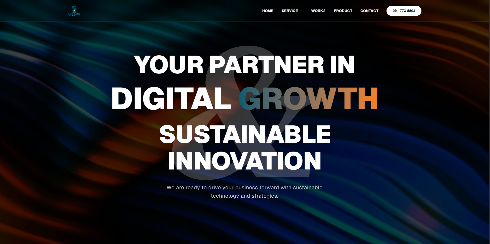
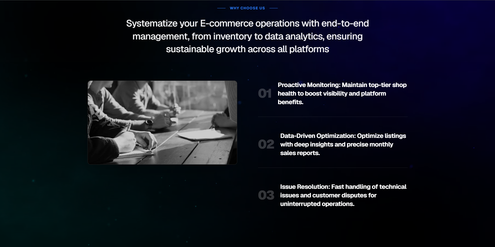
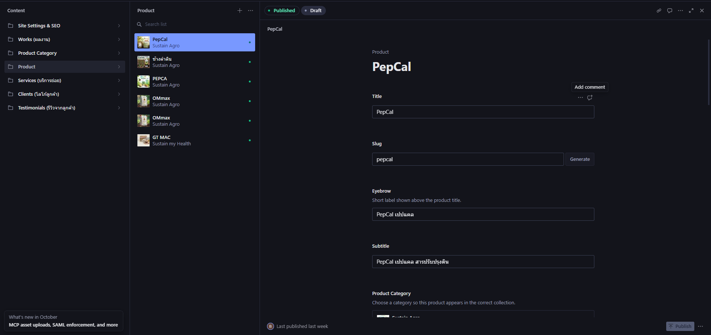

# Sustain Republix (SRG) Official Website

[](https://www.sustain-republix.com)
[](https://nextjs.org/)
[](https://react.dev/)
[](https://www.sanity.io/)
[](https://tailwindcss.com/)
[](https://www.typescriptlang.org/)
[](#license)

> **"Your Partner in Digital Growth & Sustainable Innovation"**  
> เว็บไซต์องค์กรอย่างเป็นทางการของ **Sustain Republix Group Co., Ltd.** พัฒนาด้วย Next.js 16 (App Router), React 19, Sanity Studio v4 (Embedded Headless CMS), Tailwind CSS v4, Framer Motion และ TypeScript

🌐 **Live site (maintained by the company’s team)**: [https://www.sustain-republix.com](https://www.sustain-republix.com)
This repository is the version I delivered in May 2026. The live site may have changed since then.
---

## Summary
A corporate website for Sustain Republix Group, built solo during my 5-month internship (Jan–May 2026). I handled requirement gathering, UI/UX design in Figma, frontend development with Next.js, TypeScript and Tailwind CSS, and content modeling in Sanity, so non-technical staff can manage products, services and portfolio works on their own. The site is now live in production, deployed by the company’s team.

## หน้าที่และสิ่งที่ได้ทำ (My Role)
- สร้างเว็บไซต์นี้ด้วยตัวคนเดียวในช่วง สหกิจศึกษา (ตั้งแต่ ม.ค. - พ.ค. 2026)
- เริ่มจากรวบรวม Requirements จาก บริษัท
- ออกแบบหน้าตาเว็บไซต์ และ Feature ใน Figma
- เขียนโค้ดในส่วนของ Front-end โดยแยกแต่ละหน้าให้ทำงานแบบ components สามารถเรียกใช้ซ้ำได้
- ออกแบบ schema ใน Sanity ตาม Requirement จากบริษัท ว่าในแต่ละ ข้อมูล ควรมีอะไรบ้าง (ชื่อ, รายละเอียด ฯลฯ)
- เพิ่ม SEO เข้าไปใน schema

## รูปภาพตัวอย่างเว็บไซต์ (Screenshot)




## ปัญหาและการแก้ไขปัญหา (Technical decisions)
- เพิ่มหน้า Loading เพื่อให้เว็บมีเวลาในการโหลดข้อมูลหรือภาพจาก Sanity หรือที่อื่น
- เพื่อให้ Google สามารถค้นหาได้จึงเพิ่ม SEO เข้าไป และเนื่องจากถ้าหากว่าเพิ่มเข้าไปใน แต่ละหน้า ต้องเขียนซ้ำบ่อย จึงสร้างเป็น object type เพื่อให้เรียกใช้ซ้ำได้
- ปัญหาเรื่องของ ภาพ ที่มีขนาดไม่เท่ากัน จึงแก้ปัญหาด้วยการสร้างขนาด Card ที่เท่ากันขึ้นมาและทำการ resize ภาพให้อยู่ภายในกรอบเท่านั้น
- ข้อมูลที่อาจจะน้อยไปนิดหน่อย หรือ มีมากเกิดไป จึงออกแบบให้พื้นที่ในการแสดงข้อมูลนั้น Dynamic ตามขนาดของข้อมูล
- เนื่องจากไม่มี Senior ที่คอยดูแล จึงทำการศึกษาหาข้อมูลด้วยตนเองไปพร้อมๆกับการใช้ AI

## สถานะโปรเจค (Project Status)
- ส่งมอบแล้ว และ มีการ Deploy ขึ้น Domain แล้ว โดยทีมใหม่ของบริษัท และเจ้าหน้าที่กำลังเพิ่มเนื้อหา
** repo นี้บันทึกเวอร์ชันที่ส่งมอบเมื่อ พ.ค. 2026 ทีมของบริษัทเป็นผู้ดูแลต่อ และอาจมีการเปลี่ยนแปลงภายหลัง **

---

## สารบัญ (Table of Contents)

- [สรุป Project ด้วยภาษาอังกฤษ (Summary)](#summary)
- [หน้าที่และสิ่งที่ได้ทำ (My Role)](#หน้าที่และสิ่งที่ได้ทำ-my-role)
- [รูปภาพตัวอย่างเว็บไซต์ (Screenshot)](#รูปภาพตัวอย่างเว็บไซต์-screenshot)
- [ปัญหาและการแก้ไขปัญหา (Technical decisions)](#ปัญหาและการแก้ไขปัญหา-technical-decisions)
- [สถานะโปรเจค (Project Status)](#สถานะโปรเจค-project-status)
- [ภาพรวมโปรเจกต์ (Overview)](#ภาพรวมโปรเจกต์-overview)
- [ฟีเจอร์หลักของระบบ (Core Features)](#ฟีเจอร์หลักของระบบ-core-features)
- [เทคโนโลยีที่ใช้ (Tech Stack)](#เทคโนโลยีที่ใช้-tech-stack)
- [โครงสร้างโฟลเดอร์ (Project Structure)](#โครงสร้างโฟลเดอร์-project-structure)
- [การเริ่มต้นใช้งาน (Getting Started)](#การเริ่มต้นใช้งาน-getting-started)
- [คำสั่งในโปรเจกต์ (Available Scripts)](#คำสั่งในโปรเจกต์-available-scripts)
- [ระบบจัดการเนื้อหา (Sanity Studio CMS)](#ระบบจัดการเนื้อหา-sanity-studio-cms)
  - [รายการ Schemas ทั้ง 9 ชนิด](#รายการ-schemas-ทั้ง-9-ชนิด)
  - [คู่มือตั้งค่า CORS เมื่อนำขึ้น Production](#คู่มือตั้งค่า-cors-เมื่อนำขึ้น-production)
- [ข้อมูลติดต่อและสิ่งที่ต้องอัปเดตเพิ่มเติม (Contact & TODOs)](#ข้อมูลติดต่อและสิ่งที่ต้องอัปเดตเพิ่มเติม-contact--todos)
- [สัญญาอนุญาตและลิขสิทธิ์ (License)](#สัญญาอนุญาตและลิขสิทธิ์-license)

---

## ภาพรวมโปรเจกต์ (Overview)

เว็บไซต์ **Sustain Republix Website (`srg-website`)** เป็นเว็บแอปพลิเคชันสำหรับนำเสนอภาพลักษณ์องค์กร บริการ (Services), ผลิตภัณฑ์ (Products), และผลงาน (Works) ของบริษัท โดยมีสถาปัตยกรรมแบบ **Next.js frontend + Sanity headless CMS**:
* **Frontend**: Next.js App Router ทำหน้าที่เรนเดอร์หน้าเว็บแบบ Server & Client Components พร้อมระบบ Pre-rendering (`generateStaticParams`)
* **Backend / CMS**: Sanity Studio ฝังอยู่ภายในโปรเจกต์ที่เส้นทาง `/studio` ช่วยให้ผู้ดูแลระบบสามารถจัดการเนื้อหาได้ทันที โดยไม่ต้องแยกโฮสติ้ง CMS ต่างหาก
* **Live Synchronization**: เชื่อมต่อข้อมูลด้วย `SanityLive` และ `sanityFetch` เพื่อดึงข้อมูลล่าสุดที่ถูกอัพเดท

---

## ฟีเจอร์หลักของระบบ (Core Features)

### 1. หน้าแรก (Homepage - `/`)
- **Hero Section**: ข้อความโปรโมทแบรนด์ พร้อม Reveal animations
- **Client Carousel**: แสดงโลโก้ลูกค้าและพาร์ตเนอร์ที่ไว้วางใจ (`clientLogo`) ในรูปแบบแถบเลื่อน Carousel
- **Service Highlights**: คัดเลือกบริการเด่นจากหมวดหมู่ Business strategies, E-commerce, และ Digital marketing
- **Featured Products**: แสดงผลิตภัณฑ์ที่มีการเลือกเปิดสวิตช์ `isFeatured` เพื่อที่จะนำมาแสดงบนหน้า Home ซึ่งมาจากระบบ Sanity
- **Works Showcase**: นำเสนอ 4 ผลงานล่าสุด ในรูปแบบ `Side-Scrolling Website`
- **Testimonials**: รีวิวและความคิดเห็นจากลูกค้า (`testimonial`) พร้อมภาพโปรไฟล์และโลโก้บริษัท
- **Call to Action (CTA)**: ส่วนกระตุ้นการติดต่อเชื่อมโยงไปยังหน้า Contact

### 2. ผลงานและกรณีศึกษา (Works - `/works` & `/works/[slug]`)
- **Works Grid**: หน้ารวมผลงานทั้งหมด จัดเรียงตามวันที่สร้างล่าสุด
- **Editorial Case Study Layout**: หน้ารายละเอียดผลงานแบบเล่าเรื่อง 5 ขั้นตอน:
  1. *The Context*: แบนเนอร์หัวเรื่อง (`WorkHero`) และคำอธิบายภาพรวม (`WorkDescription`)
  2. *The Journey (Scrollytelling)*: เล่าขั้นตอนการทำงานแบบตรึงแถบเนื้อหาและเปลี่ยนภาพตามการเลื่อนหน้าจอ (`stickySections`)
  3. *The Visual Proof*: เครื่องมือเลื่อนเปรียบเทียบภาพก่อน-หลัง (`BeforeAfterSlider`) และแกลเลอรีภาพผลงาน (`WorkGallery`)
  4. *The Impact (Metrics)*: กล่องแสดงตัวเลขสถิติความสำเร็จพร้อมเอฟเฟกต์นับตัวเลขแอนิเมชัน (`WorkMetrics`)
  5. *The Next Step (Back to all work)*: ปุ่มย้อนกลับไปชมผลงานทั้งหมด

### 3. แคตตาล็อกผลิตภัณฑ์ (Products - `/products`, `/products/category/[slug]`, `/products/[slug]`)
- **Category Overview**: หน้ารวมหมวดหมู่ผลิตภัณฑ์ พร้อมแสดงจำนวนสินค้าในแต่ละหมวดหมู่แบบไดนามิก
- **Product List by Category**: หน้ารายการสินค้าเฉพาะตามหมวดหมู่ที่เลือก
- **Product Detail**: หน้ารายละเอียดสินค้า บางส่วนจะขึ้นโชว์ก็ต่อเมื่อมีข้อมูล ประกอบด้วยคำอธิบาย, วิดีโอพรีวิวการใช้งาน (`motionVideo`), ตราใบรับรองมาตรฐาน (`certifications`), รางวัลที่ได้รับ (`awards`), และรายการสินค้าที่เกี่ยวข้อง (`relatedProducts`)

### 4. บริการขององค์กร (Services - `/services/[slug]`)
- **Immersive Video Background**: หน้าบริการมีพื้นหลังวิดีโอแบบเต็มจอ (`Videos-service-BG_cfbc21.mp4`)
- **Why Choose Us & Benefits**: รายการจุดเด่นและข้อดีของแต่ละบริการ
- **Related Portfolios**: แสดงผลงานจริงที่สร้างขึ้นภายใต้บริการนั้นๆ

### 5. หน้าติดต่อ (Contact - `/contact`)
- ข้อมูลช่องทางการติดต่ออย่างเป็นทางการ ทั้งเบอร์โทรศัพท์ อีเมลตรง และแผนที่/ที่ตั้งสำนักงาน

### 6. ประสบการณ์ผู้ใช้และการนำทาง (UI / UX)
- **Page Transition Loader (`TransitionLoader`)**: แถบหน้าต่างโหลดคั่นระหว่างเปลี่ยนหน้าเว็บ เพื่อความลื่นไหล
- **Brand Loader (`BrandLoader`)**: หน้าต่างโหลดแสดงสัญลักษณ์และสโลแกนของ Sustain Republix Group
- **Scroll-Aware Navbar**: แถบเมนูด้านบน เมื่อเลื่อนหน้าจอ (ซ่อนเมื่อเลื่อนลง แสดงเมื่อเลื่อนขึ้น) พร้อม Mega Menu สำหรับ Service แสดงหมวดหมู่บริการทั้ง 8 หมวด
- **Dynamic SEO**: ฟังก์ชัน `generateDynamicMetadata` ดึง `metaTitle` และ `metaDescription` จาก Sanity เพื่อปรับค่า SEO ตามแต่ละหน้า

---

## เทคโนโลยีที่ใช้ (Tech Stack)

| หมวดหมู่ | เทคโนโลยี / เครื่องมือ | เวอร์ชันในโปรเจกต์ | วัตถุประสงค์การใช้งาน |
| :--- | :--- | :--- | :--- |
| **Framework** | [Next.js](https://nextjs.org/) | `16.1.7` | App Router, Server & Client Components, Dynamic Routing |
| **UI Library** | [React](https://react.dev/) / [React DOM](https://react.dev/) | `19.2.3` | แกนหลักในการสร้าง User Interface |
| **Language** | [TypeScript](https://www.typescriptlang.org/) | `^5` | Type-safety ทั้งฝั่ง Frontend และ Sanity Schema |
| **Headless CMS** | [Sanity Studio](https://www.sanity.io/) | `^4.22.0` | ระบบจัดการเนื้อหาฝังในตัวที่ `/studio` |
| **CMS Client** | [next-sanity](https://github.com/sanity-io/next-sanity) | `^11.6.12` | เชื่อมต่อข้อมูลระหว่าง Next.js และ Sanity Content Lake |
| **Image Builder** | [@sanity/image-url](https://www.sanity.io/docs/image-url) | `^1.2.0` | จัดการและดึง URL รูปภาพจาก Sanity CDN |
| **Query Playground** | [@sanity/vision](https://www.sanity.io/docs/the-vision-plugin) | `^4.22.0` | เครื่องมือทดสอบ GROQ Query ใน Sanity Studio |
| **Styling** | [Tailwind CSS](https://tailwindcss.com/) | `^4` | Utility-first CSS สำหรับการจัดสไตล์ |
| **PostCSS** | [@tailwindcss/postcss](https://tailwindcss.com/) | `^4` | ปลั๊กอินประมวลผล Tailwind CSS ร่วมกับ PostCSS |
| **Animation** | [Framer Motion](https://www.framer.com/motion/) | `^12.38.0` | จัดการแอนิเมชัน Transitions, Carousel, และ Reveal |
| **Linting** | [ESLint](https://eslint.org/) | `^9` | ตรวจสอบคุณภาพและมาตรฐานโค้ด (`eslint-config-next: 16.1.7`) |

---

## โครงสร้างโฟลเดอร์ (Project Structure)

```text
SRG-Website/
├── app/                                # Next.js App Router
│   ├── components/                     # คอมโพเนนต์แยกตามส่วนการทำงาน
│   │   ├── home/                       # ส่วนประกอบหน้าแรก (Hero, Services, Products, Works, ฯลฯ)
│   │   ├── product/                    # คอมโพเนนต์หน้าสินค้า (Categories, Detail, Story, CTA)
│   │   ├── services/                   # คอมโพเนนต์หน้าบริการ (Hero, WhyChooseUs, Portfolio, CTA)
│   │   ├── ui/                         # คอมโพเนนต์ส่วนกลาง (Navbar, Footer, Loaders)
│   │   ├── works/                      # คอมโพเนนต์หน้าผลงาน (Scrollytelling, Slider, Metrics)
│   │   └── Reveal.tsx                  # Wrapper สำหรับ Fade-in Animation
│   ├── contact/                        # เส้นทางหน้าติดต่อ (/contact)
│   ├── lib/                            # ฟังก์ชันตัวช่วย (seoHelper.ts สำหรับ Dynamic SEO)
│   ├── products/                       # เส้นทางหน้าสินค้า (/products, /products/category/[slug], /products/[slug])
│   ├── services/                       # เส้นทางหน้าบริการ (/services/[slug])
│   ├── studio/[[...tool]]/             # เส้นทางฝัง Sanity Studio (/studio)
│   ├── types/                          # TypeScript Type Definitions สำหรับ Sanity
│   ├── works/                          # เส้นทางหน้าผลงาน (/works, /works/[slug])
│   ├── error.tsx                       # หน้าจัดการข้อผิดพลาดระดับ Global
│   ├── globals.css                     # ไฟล์ CSS หลักและคอนฟิก Tailwind
│   ├── layout.tsx                      # Root Layout (รวม Font, Navbar, Footer, SanityLive)
│   ├── loading.tsx                     # หน้าแสดงสถานะการโหลดระดับ Global
│   └── page.tsx                        # หน้าแรกของเว็บไซต์ (Home Page)
├── public/                             # ไฟล์ Static Assets
│   └── assets/                         # โลโก้บริษัท (logo_0.png, pure_logo_0.png)
├── sanity/                             # คอนฟิกและการจัดการ Sanity CMS
│   ├── lib/                            # ฟังก์ชันเชื่อมต่อ (client.ts, live.ts, image.ts)
│   ├── schemaTypes/                    # สกีมาสำหรับจัดการเนื้อหาทั้ง 9 ชนิด
│   ├── env.ts                          # ตรวจสอบและดึงค่าตัวแปรสภาพแวดล้อมของ Sanity
│   └── structure.ts                    # กำหนดโครงสร้างเมนูใน Sanity Studio (Singleton siteSettings)
├── .env.example                        # ไฟล์ตัวอย่าง Environment Variables สำหรับ GitHub
├── next.config.ts                      # คอนฟิก Next.js (กำหนด Remote Image Domains)
├── package.json                        # รายการ Dependencies และคำสั่งรันระบบ
├── sanity.cli.ts                       # คอนฟิกสำหรับ Sanity CLI (Typegen & Schema Extract)
├── sanity.config.ts                    # คอนฟิกหลักของ Sanity Studio (/studio)
├── sanity.types.ts                     # ไฟล์ Type อัตโนมัติจาก Sanity Typegen
└── tsconfig.json                       # คอนฟิกการคอมไพล์ TypeScript
```

---

## การเริ่มต้นใช้งาน (Getting Started)

### 1. ความต้องการของระบบ (Prerequisites)
- [Node.js](https://nodejs.org/) เวอร์ชัน 20 ขึ้นไป
- ตัวจัดการแพ็กเกจ: `npm`, `pnpm`, หรือ `yarn`

### 2. การโคลนและติดตั้งโปรเจกต์ (Clone & Install)
```bash
# โคลนโปรเจกต์จาก GitHub
git clone https://github.com/Kaivasas/SRG-Website.git

# เข้าสู่โฟลเดอร์โปรเจกต์
cd SRG-Website

# ติดตั้งแพ็กเกจทั้งหมด
npm install
```

### 3. การตั้งค่าตัวแปรสภาพแวดล้อม (Environment Variables)
คัดลอกไฟล์ `.env.example` ไปเป็น `.env.local`:
```bash
cp .env.example .env.local
```

จากนั้นเปิดไฟล์ `.env.local` แล้วใส่ค่า Configuration ของ Sanity ให้ถูกต้อง:
```bash
# รหัส Sanity Project
NEXT_PUBLIC_SANITY_PROJECT_ID=your_sanity_project_id

# ชื่อ Dataset (ค่าเริ่มต้นคือ production)
NEXT_PUBLIC_SANITY_DATASET=production

# เวอร์ชัน API
NEXT_PUBLIC_SANITY_API_VERSION=2026-03-27
```

### 4. การรันในโหมดพัฒนา (Development Server)
```bash
npm run dev
```

เปิดเบราว์เซอร์ไปที่:
* **หน้าเว็บไซต์**: [http://localhost:3000](http://localhost:3000)
* **หน้า Sanity Studio (CMS)**: [http://localhost:3000/studio](http://localhost:3000/studio)

---

## คำสั่งในโปรเจกต์ (Available Scripts)

ในไฟล์ [`package.json`](package.json) มีคำสั่งที่ใช้งานได้ดังนี้:

| คำสั่ง | คำสั่งจริงเบื้องหลัง | คำอธิบาย |
| :--- | :--- | :--- |
| `npm run dev` | `next dev` | รันเซิร์ฟเวอร์ในโหมดพัฒนา (Development) ที่พอร์ต 3000 |
| `npm run build` | `next build` | บิลด์โปรเจกต์สำหรับขึ้นใช้งานบน `Production` |
| `npm run start` | `next start` | รันเว็บที่ build แล้ว (ใช้หลัง npm run build) เพื่อทดสอบเหมือน production |
| `npm run lint` | `eslint` | ให้ ESLint ตรวจโค้ด หาข้อผิดพลาดและโค้ดที่ไม่ตรงมาตรฐาน |
| `npm run typegen` | `sanity schema extract && sanity typegen generate` | สกัด Sanity Schema และสร้าง TypeScript types ใน `sanity.types.ts` อัตโนมัติ |

---

## ระบบจัดการเนื้อหา (Sanity Studio CMS)

ระบบ Sanity Studio ถูกฝังอยู่ในโปรเจกต์ Next.js โดยตรง สามารถเข้าใช้งานได้ที่ URL `/studio` เมื่อล็อกอินด้วยบัญชีที่มีสิทธิ์ในโปรเจกต์ Sanity จะสามารถจัดการเอกสารต่างๆ ได้ทันที

### รายการ Schemas ทั้ง 9 ชนิด

1. **`siteSettings` (Singleton)**: ตั้งค่าชื่อเว็บไซต์ (`siteTitle`) และค่า SEO พื้นฐานของทั้งเว็บ (`Default Global SEO`)
2. **`work` (Works / ผลงาน)**: เก็บข้อมูลผลงาน, ลูกค้า (`client`), ปีที่จัดทำ (`year`), แท็ก, แบนเนอร์, รูปเปรียบเทียบก่อน-หลัง (`beforeAfter`), บล็อกเนื้อหาเลื่อนเรื่องราว (`stickySections`), แกลเลอรี (`gallery`), และตัวเลขสถิติผลลัพธ์ (`metrics`)
3. **`service` (Services / บริการย่อย)**: จัดการบริการย่อย โดยมีหมวดหมู่บริการ (`category`) กำหนดไว้ 8 หมวด:
   - `Business strategies`
   - `Digital marketing`
   - `E-commerce`
   - `Media production`
   - `Live streaming`
   - `Event organization`
   - `Design`
   - `Influencer management`
   พร้อมช่องใส่หัวข้อและข้อดี (Benefits), ภาพประกอบ, และการเชื่อมโยงผลงานที่เกี่ยวข้อง
4. **`productCategory` (Product Category / หมวดหมู่สินค้า)**: ชื่อหมวดหมู่, Slug, คำอธิบาย, และรูปภาพหน้าปกสำหรับหมวดหมู่นั้นๆ
5. **`product` (Product / ข้อมูลผลิตภัณฑ์)**: ชื่อสินค้า, สโลแกนสั้น (Eyebrow & Subtitle), หมวดหมู่ที่อยู่ (`productCategory`), คำอธิบายยาว, ภาพปก Thumbnail, ภาพแบนเนอร์หลัก, วิดีโอ Motion (`motionVideo`), ตราใบรับรอง (`certifications`), รางวัล (`awards`), และสวิตช์เลือกแสดงในหน้าแรก (`isFeatured`)
6. **`clientLogo` (Clients / โลโก้ลูกค้า)**: ชื่อแบรนด์ และ ภาพโลโก้ลูกค้า/พาร์ตเนอร์
7. **`testimonial` (Testimonials / รีวิวจากลูกค้า)**: ชื่อลูกค้า, ตำแหน่ง, บริษัท, บทรีวิว (`quote`), ภาพโปรไฟล์, และโลโก้บริษัท
8. **`seo` (SEO Object Type)**: วัตถุเก็บ `metaTitle` (สูงสุด 60 ตัวอักษร) และ `metaDescription` (สูงสุด 160 ตัวอักษร)
9. **`badgeItem` (Badge Item Object Type)**: วัตถุเก็บชื่อและภาพสำหรับตราสัญลักษณ์หรือรางวัล

---

### คู่มือตั้งค่า CORS เมื่อนำขึ้น Production

เมื่อนำเว็บไซต์ไป Deploy บนโดเมนจริง เช่น `https://www.sustain-republix.com` หรือบน Vercel ระบบ Sanity Studio จะยังไม่สามารถดึงหรือบันทึกข้อมูลได้จนกว่าจะเพิ่มโดเมนในระบบความปลอดภัย (CORS Origins) ตามขั้นตอนดังนี้:

1. เข้าสู่ระบบที่ [Sanity Management Dashboard](https://www.sanity.io/manage)
2. เลือกโปรเจกต์ของเว็บไซต์ที่คุณต้องการเชื่อมต่อ
3. ไปที่แท็บ **API** จากเมนูด้านบน
4. เลื่อนลงมาที่หัวข้อ **CORS Origins** แล้วคลิกปุ่ม **Add CORS Origin**
5. ในช่อง **Origin** ให้กรอกโดเมนของเว็บไซต์ เช่น:
   ```text
   https://www.sustain-republix.com
   ```
   *(หากมีการ Deploy บน Vercel ให้เพิ่ม URL ของ Vercel เช่น `https://your-project.vercel.app` เข้าไปด้วย)*
6. ติ๊กเครื่องหมายถูกที่ช่อง **Allow credentials**
7. คลิกปุ่ม **Save** เป็นอันเสร็จสิ้น

---

## สิ่งที่ต้องอัปเดตเพิ่มเติม (Contact & TODOs)
- [ ] **TODO: Social Media Links**: ปัจจุบันในไฟล์ [`app/components/ui/Footer.tsx`](app/components/ui/Footer.tsx) ลิงก์ของ Facebook, LinkedIn, และ TikTok ยังถูกตั้งค่าเป็น `href="#"` รอการนำ URL บัญชีทางการของบริษัทมาอัปเดตแทนที่

---

## สัญญาอนุญาตและลิขสิทธิ์ (License)

Copyright © 2026 **Sustain Republix Group Co., Ltd.** All rights reserved.

ซอร์สโค้ดและเนื้อหาในโปรเจกต์นี้เป็นกรรมสิทธิ์ของบริษัท Sustain Republix Group Co., Ltd. ไม่อนุญาตให้ทำซ้ำ ดัดแปลง หรือเผยแพร่เพื่อการค้าโดยไม่ได้รับอนุญาตเป็นลายลักษณ์อักษรจากบริษัท
